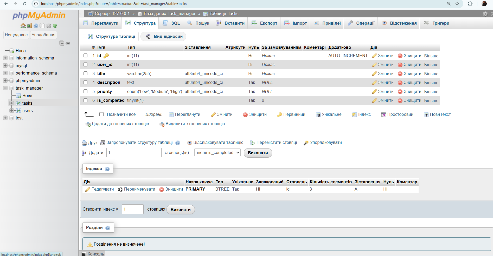
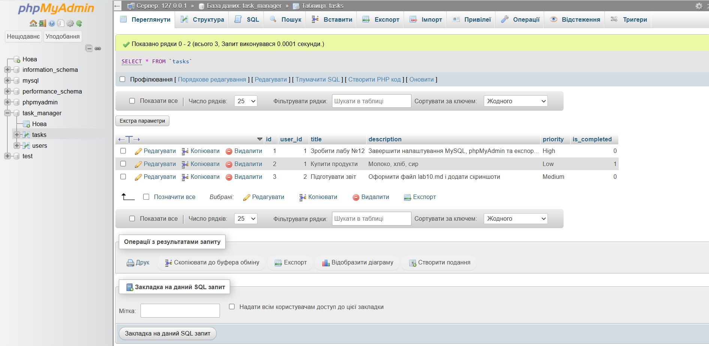

# Лабораторна робота №12 (Тема: Налаштування СКБД MySQL та проектування таблиць)

## Відповіді на контрольні запитання

1. **Що таке СКБД (СУБД)? Чим відрізняється база даних від phpMyAdmin?**
   **СКБД** — це серверне програмне забезпечення (наприклад, MySQL/MariaDB), яке безпосередньо зберігає, обробляє та керує даними. **phpMyAdmin** — це лише графічний веб-клієнт, який дозволяє зручно взаємодіяти з СКБД через браузер замість командного рядка.

2. **Для чого використовується атрибут «Автоприращение» (AUTO_INCREMENT / A_I)?**
   Він автоматично збільшує значення поля `id` на 1 при додаванні кожного нового запису. Це гарантує унікальний ідентифікатор для кожного рядка без необхідності вводити його вручну.

3. **Що таке PRIMARY KEY (Первинний ключ) і навіщо він потрібен?**
   Це поле (або набір полів), яке однозначно ідентифікує кожен запис у таблиці. Первинний ключ запобігає дублюванню рядків і використовується для побудови зв'язків між реляційними таблицями.

4. **Два типи текстових даних у MySQL та їх відмінності:**
   - `VARCHAR(N)` — рядок змінної довжини з обмеженням до N символів. Обсяг пам'яті виділяється відповідно до реального розміру введеного тексту.
   - `TEXT` — призначений для збереження великих обсягів тексту (до 65 535 символів) без задання конкретної фіксованої довжини при створенні поля.

5. **Чому для паролів виділяють VARCHAR довжиною 255?**
   Паролі у базах даних зберігаються не у відкритому вигляді, а у вигляді захешованого рядка (наприклад, за допомогою алгоритмів bcrypt, Argon2, SHA-256). Оскільки хеш має велику довжину, запас у 255 символів гарантує, що будь-який зашифрований хеш повністю поміститься у базі.

---

## Звіти та скриншоти виконання

### 1. Структура таблиці `tasks`

### 2. Перегляд доданих тестових даних у таблиці `tasks`
